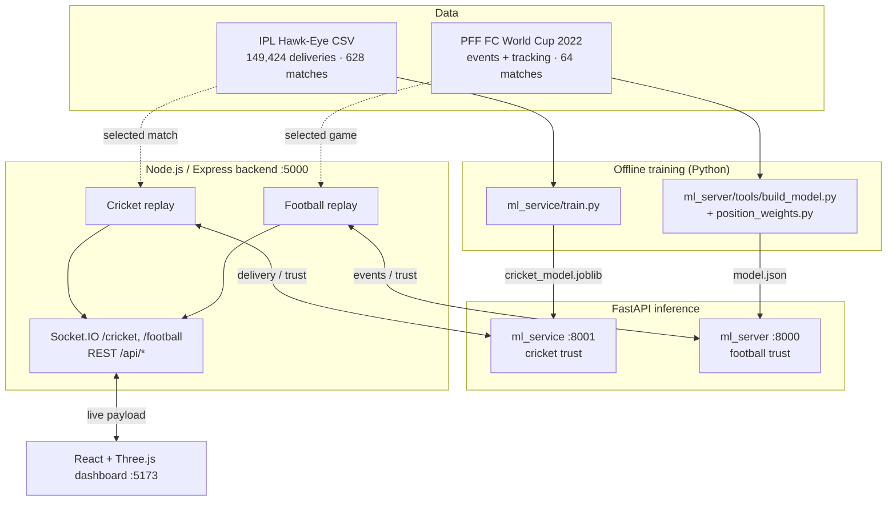

# Chokehold: Quantifying "Choking" in Cricket and Football

Chokehold replays real matches ball by ball (cricket) and event by event (football). For every player it estimates three things: **how hard each action was**, **how much was at stake**, and **whether the player is performing below his own normal level for that pressure**. The result is a live **0–100 trust score** on an interactive 3-D dashboard. A score below **40** flags a possible choke.

> **What the score is and is not.** The trust score is a pressure-adjusted performance index built from machine-learning expectations. It is **not** proof of a psychological cause, and it is not a calibrated probability that a player is choking. The APIs say this explicitly (`chokingProbability: null`, `status: "trained_reliability_model_not_causal"`).

Course project for **BCSE306L Artificial Intelligence**, School of Computer Science and Engineering (SCOPE), VIT.
Team: Jim Mathew K (24BCE0493) · Shakya Sopory (24BCE0371) · Syed Saad Ali (24BCE0576)

---

## Contents

1. [Features](#1-features)
2. [Architecture](#2-architecture)
3. [Repository layout](#3-repository-layout)
4. [Prerequisites](#4-prerequisites)
5. [Data](#5-data)
6. [Setup and run (step by step)](#6-setup-and-run-step-by-step)
7. [Configuration (environment variables)](#7-configuration-environment-variables)
8. [Using the dashboard](#8-using-the-dashboard)
9. [How each part works](#9-how-each-part-works)
10. [APIs and socket events](#10-apis-and-socket-events)
11. [Results](#11-results)
12. [Tests and model rebuilding](#12-tests-and-model-rebuilding)
13. [Troubleshooting](#13-troubleshooting)
14. [Known limitations and roadmap](#14-known-limitations-and-roadmap)
15. [Team](#15-team)
16. [References](#16-references)

---

## 1. Features

| | Cricket (IPL, Hawk-Eye) | Football (FIFA World Cup 2022, PFF FC) |
|---|---|---|
| Unit scored | every delivery, batter and bowler | every on-ball event, every player involved |
| Expected outcome | 4 gradient-boosting models: expected runs (batter, bowler) and dismissal probability | position-aware logistic difficulty models for 13 action types |
| Pressure | 0–100 index from innings phase, wickets lost and chase strain | Ψ = stakes × in-game leverage × pitch-zone consequence |
| Player state | empirical-Bayes baseline + pressure gap + pressure-weighted moving average | 8-skill Kalman filter with pressure sensitivity β |
| Uncertainty | 90% split-conformal intervals for expected runs | 95% intervals (epistemic + aleatoric) |
| Explanation | per-delivery residual breakdown | exact Shapley attributions |
| Speed | ≈ 6 ms per delivery | ≈ 14 ms per event for all 50 players |

The dashboard runs on React + Three.js. It has overview, broadcast and ball-cam cameras, Hawk-Eye ball trajectories, a player card with live versus original trust, and a red choke flag.

---

## 2. Architecture



There are four processes, one per folder:

| Process | Folder | Port | Required for |
|---|---|---|---|
| Cricket ML service (FastAPI) | `ml_service/` | 8001 | cricket trust scores |
| Football ML server (FastAPI) | `ml_server/` | 8000 | football trust scores |
| Backend (Express + Socket.IO) | `backend/` | 5000 | everything |
| Frontend (React + Vite) | `frontend/` | 5173 | everything |

Each sport works on its own. Without the PFF data the football replay simply doesn't start and cricket still runs. If an ML service is down, the replay keeps going and trust stays at a neutral default.

---

## 3. Repository layout

```text
codebase/
├── README.md                       ← this file
├── frontend/                       React 19 + Vite 8 + Three.js dashboards
│   └── src/
│       ├── App.jsx                 routes: /  /cricket  /football
│       ├── pages/                  Home.jsx, CricketDashboard.jsx, FootballDashboard.jsx
│       ├── hooks/useMatchSocket.js Socket.IO client, merges roster + live data (BACKEND_URL = http://localhost:5000)
│       ├── components/
│       │   ├── dashboard/          shared shell: DashboardLayout, PlayerNav (sidebar), PlayerDetails (player card),
│       │   │                       TeamBench, Avatar, trust.js (CHOKE_THRESHOLD = 40, colour tones)
│       │   ├── cricket/            CricketField (3-D ground), Ball + trajectory.js (Hawk-Eye path),
│       │   │                       geometry.js (ground/pitch dimensions), PlayerDot, TeamPlayers, PlayerCard
│       │   ├── football/           FootballField (pitch + ball cam), Ball, PlayerDot, PlayerCard
│       │   └── common/PlayerTag.jsx
│       ├── data/playerProfiles.js  static profile lookup
│       └── styles/                 dashboard.css, cricket.css, home.css
├── backend/                        Node.js 24 + Express 5 + Socket.IO 4
│   ├── data/
│   │   ├── mensIPLHawkeyeStats.csv cricket data (included)
│   │   ├── pff_wc2022/             football data (NOT included, 5.4 GB, see §5)
│   │   └── Sample_Game_1_*.csv     Metrica sample game (legacy, used by early prototypes only)
│   └── src/
│       ├── server.js               HTTP + sockets, starts both replays on boot
│       ├── routes/apiRoutes.js     REST endpoints (§10)
│       ├── controllers/
│       │   ├── cricketPipelineController.js  cricket replay that drives the dashboard
│       │   ├── cricketController.js          second cricket replay behind /api/cricket/* (see §14)
│       │   └── pipelineController.js         PFF football replay
│       ├── services/
│       │   ├── cricketTrustClient.js  ordered, self-resyncing client for the cricket ML service
│       │   ├── cricketMlService.js    HTTP call to /evaluate/cricket/post-ball
│       │   ├── mlService.js           batched, non-blocking client for the football ML server
│       │   ├── pffLoader.js           PFF loader, streams .jsonl.bz2 tracking (Python decompressor or JS fallback)
│       │   └── dbService.js           persistence stub (disabled)
│       ├── sockets/                socketManager.js (both namespaces), cricketSocketManager.js (late-joiner frame)
│       └── config/                 pff.js (football settings), matchMetadata.js, state.js, cricketState.js
├── ml_service/                     Cricket ML (Python / FastAPI)
│   ├── features.py                 21 features, pressure index, label helpers (shared by training and inference)
│   ├── train.py                    grouped split, 4 models, baselines, conformal, player profiles
│   ├── main.py                     FastAPI app: /health, /model/info, /evaluate/cricket/post-ball
│   ├── requirements.txt
│   └── artifacts/                  cricket_model.joblib + metrics.json (generated, not committed)
├── ml_server/                      Football ML (Python / FastAPI)
│   ├── app/main.py, app/schemas.py endpoints and request models
│   ├── app/football/               game.py, features.py, residual.py, pressure.py, priors.py,
│   │                               kalman.py, trust.py, constants.py, state.py, config/*.json
│   ├── app/data/pff_loader.py
│   ├── tools/                      position_stats.py, position_weights.py, build_model.py
│   ├── tests/                      replay_test.py, smoke_test.py
│   └── docs/trust_formula.md       full mathematical specification of the football trust score
└── docs/                           notes from the first cricket prototype (historical)
```

---

## 4. Prerequisites

| Tool | Version | Check |
|---|---|---|
| Node.js + npm | 20+ (developed on 24) | `node -v` |
| Python | 3.12 (3.10+ works) | `python --version` |
| Git | any | `git --version` |
| Browser | recent Chrome / Edge / Firefox with WebGL | |

Hardware: any 64-bit laptop CPU and 8 GB RAM (16 GB recommended). No GPU is needed. Allow 2 GB of disk, or about 10 GB with the PFF dataset.

Commands below are given for **Windows PowerShell** and **macOS / Linux**. Run them from the repository root unless a `cd` says otherwise.

---

## 5. Data

### Cricket: IPL Hawk-Eye (included)

`backend/data/mensIPLHawkeyeStats.csv` (19.9 MB) comes from the public [HawkeyeStats](https://github.com/alittlefitness/HawkeyeStats) repository, a tidy export of ICC ball-tracking data. It has 149,424 rows (one per delivery, extras included) from 628 IPL matches, with 467 players and 24 columns:

| Column(s) | Meaning |
|---|---|
| `matchId`, `delivery`, `ball` | match; `innings.over.event` (e.g. `2.15.4`); legal-ball counter. Extras mean one row is not always one legal ball |
| `batter(Id)`, `nonStriker(Id)`, `bowler(Id)` | players |
| `rightHandedBat`, `rightArmedBowl`, `bowlingStyle` | handedness, arm, style (`FAST_SEAM`, `MEDIUM_SEAM`, `SEAM`, `LEG_SPIN`, `OFF_SPIN`, `ORTHODOX`, `UNORTHODOX`) |
| `ballSpeed` | release speed in m/s; `-1` = not tracked (6% of rows) |
| `pitchX`, `pitchY` | bounce point: lateral offset from middle stump and distance from the batter's stumps (m) |
| `stumpsX`, `stumpsY` | where the ball passes the stumps: lateral offset and height (m) |
| `fieldX`, `fieldY` | where the ball was fielded, 0–96 grid with centre (48, 48); `(5,5)` = no shot, `(0,0)` = none |
| `runs`, `batterRuns`, `bowlerRuns`, `extras` | total runs, runs to batter, runs charged to bowler; `Wd`, `Nb`, `Lb`, `B` |
| `dismissalDetails` | scorecard text, e.g. `c Harbhajan Singh b James Franklin`, `run out (Ambati Rayudu)` |

### Football: PFF FC World Cup 2022 (download separately)

This data is free but needs registration: [PFF FC "Enhanced 2022 World Cup Dataset"](https://www.blog.fc.pff.com/blog/enhanced-2022-world-cup-dataset). It is about 5.4 GB and is git-ignored. Place it like this:

```text
backend/data/pff_wc2022/
├── Metadata/<gameId>.json
├── Rosters/<gameId>.json
├── Event Data/<gameId>.json
├── Tracking Data/<gameId>.jsonl.bz2
└── players.csv
```

The fitted football model (`ml_server/app/football/config/model.json`) is committed. You only need the raw PFF files to **replay** a match or to **rebuild** the model.

---

## 6. Setup and run (step by step)

### Step 1: Clone

```bash
git clone https://github.com/SekiroHamada/codebase.git
cd codebase
```

### Step 2: Python environment

One virtual environment can serve both ML services.

```powershell
# Windows PowerShell
python -m venv .venv
.\.venv\Scripts\python.exe -m pip install -r ml_service\requirements.txt -r ml_server\requirements.txt
```

```bash
# macOS / Linux
python3 -m venv .venv
.venv/bin/pip install -r ml_service/requirements.txt -r ml_server/requirements.txt
```

In the rest of this guide, `python` means this environment's interpreter: `.\.venv\Scripts\python.exe` on Windows or `.venv/bin/python` on macOS/Linux. You can also activate the environment first with `.\.venv\Scripts\Activate.ps1` or `source .venv/bin/activate`.

### Step 3: Node dependencies

```bash
cd backend  && npm install && cd ..
cd frontend && npm install && cd ..
```

> If PowerShell says `node`/`npm` is not recognised, run `$env:Path = "C:\Program Files\nodejs;" + $env:Path` in that terminal, or use `npm.cmd`.

### Step 4: Train the cricket model (once, about 15 s)

```bash
cd ml_service
python train.py --csv ../backend/data/mensIPLHawkeyeStats.csv --exclude-match 2
cd ..
```

This writes `ml_service/artifacts/cricket_model.joblib` and `metrics.json` and prints the held-out metrics (§11). `--exclude-match` is the match you will replay. It is kept out of training, calibration and test so the demo is leakage-free, and **it must equal `CRICKET_MATCH_ID` in Step 5**.

### Step 5: Start the services (four terminals, every session)

**Terminal 1: cricket ML service (port 8001)**
```bash
cd ml_service
python -m uvicorn main:app --port 8001
```
Check <http://127.0.0.1:8001/health>. You should see `{"status":"ok","engine":"trained-context-eb-conformal-v3","trained_model":true}`.

**Terminal 2: football ML server (port 8000), optional, needs PFF data to be useful**
```bash
cd ml_server
python -m uvicorn app.main:app --port 8000
```
Check <http://127.0.0.1:8000/health> and <http://127.0.0.1:8000/docs>.

**Terminal 3: backend (port 5000)**
```powershell
# Windows PowerShell
cd backend
$env:CRICKET_MATCH_ID = "2"
$env:CRICKET_DELIVERY_INTERVAL_MS = "3000"   # optional, default 7000
npm run dev
```
```bash
# macOS / Linux
cd backend
CRICKET_MATCH_ID=2 CRICKET_DELIVERY_INTERVAL_MS=3000 npm run dev
```
Check <http://localhost:5000/api/health>. The log should show `Initialized Hawkeye cricket pipeline: match 2, 230 deliveries ...`. Without PFF data you will also see `[PFF] football pipeline failed to start: ENOENT ...`, which is expected and harmless.

**Terminal 4: frontend (port 5173)**
```bash
cd frontend
npm run dev
```
Open <http://localhost:5173>.

Start order doesn't strictly matter. The backend retries the ML services and resynchronises when they come up.

---

## 7. Configuration (environment variables)

All variables are read by the **backend** (`backend/`).

**Cricket**

| Variable | Default | Meaning |
|---|---|---|
| `CRICKET_MATCH_ID` | first match in the CSV (`2`) | match to replay; must match `--exclude-match` used in training |
| `CRICKET_DELIVERY_INTERVAL_MS` | `7000` | time between deliveries on the dashboard |
| `CRICKET_ML_URL` (or `ML_SERVICE_URL`) | `http://127.0.0.1:8001` | cricket ML service |
| `CRICKET_REPLAY_INTERVAL_MS` | `2000` | interval of the secondary replay behind `/api/cricket/select` and `/restart` only |

**Football**

| Variable | Default | Meaning |
|---|---|---|
| `PFF_GAME_ID` | `10517` (2022 final, ARG v FRA) | any id from `GET :8000/games` (64 games) |
| `PFF_DATA_DIR` | `backend/data/pff_wc2022` | PFF folder |
| `REPLAY_SPEED` | `1` | e.g. `5` for 5× |
| `START_MINUTE` | `0` | jump into the match (earlier events are still sent to the ML server) |
| `REPLAY_LOOP` | off | `1` restarts the match when it ends |
| `ML_URL` | `http://127.0.0.1:8000` | football ML server |
| `PYTHON` | auto (`python`, `python3`, `py`) | interpreter used to decompress tracking about 10× faster than the JS fallback |

The frontend's backend address is set in `frontend/src/hooks/useMatchSocket.js` (`BACKEND_URL = 'http://localhost:5000'`).

---

## 8. Using the dashboard

**Home (`/`).** Choose **Football** or **Cricket**.

**Cricket (`/cricket`)**
- **Left sidebar:** players currently on the field (striker and bowler) with live trust. The colour tone is green at 75 and above, amber from 50 to 75, and red below 50. The search box filters players. The legend marks a choke as trust below 40.
- **Centre:** the 3-D ground. The label shows `bowler → batter`, speed (km/h) and bowling style. **Overview / Broadcast / Ball cam** switch the camera, and the delivery is animated from the Hawk-Eye pitching and stumps points (a visualisation, not a full physical reconstruction).
- **Badge:** innings and over, e.g. `Inn 1 · 7.6 ov`. **Scoreboard:** runs/wickets for both teams.
- **Team Players strips:** both squads. Click a name or a dot to open the **player card**, which shows live trust, original trust, the change, and on-field or bench status.
- The replay starts automatically on backend boot and loops after a 15 s pause at the end. It is **shared by all viewers**.

**Football (`/football`)**
- 2-D pitch with every on-field player (H/A labels) moving with the tracking data, and the ball.
- Sidebar with home/away players and trust, match clock, goals, and home/away benches.
- Click a player for his card (trust plus live position in 0–100 units and metres). **Ball cam** follows the ball in 3-D.
- Full model output per player is at `GET http://localhost:5000/api/football/state`: choke probability, 95% interval, Shapley attributions, form, β and Ψ.

---

## 9. How each part works

### 9.1 Cricket ML (`ml_service/`)

**Features (`features.py`).** There are 21 features that describe only the situation *before* the ball, so the outcome is never an input:
- match state: innings, runs, wickets and legal balls so far, target, required and current run rate, balls remaining, phase, pressure index;
- players: batter and bowler id, handedness, arm, style;
- Hawk-Eye: speed, `pitchX/Y`, `stumpsX/Y`. Values of `-1` or outside physical bounds become missing (NaN). The models handle NaN natively, and nothing is imputed.

**Pressure index (0–100).** This is an engineering proxy for match-context pressure. With φ = legal balls / 120, w = wickets / 10 and c = chase strain:

```text
P = 100 · [0.25·φ^1.7 + 0.20·w + 0.35·c + 0.20·φ·(0.4 + 0.6·w)]
c = sigmoid((RRR − 8) / 2.5) · φ   in the second innings while runs are still needed, else 0
LOW < 40 ≤ MEDIUM < 70 ≤ HIGH
```

**Training (`train.py`).**
1. Rebuild pre-ball totals by cumulative sums per match/innings. The target is first-innings runs + 1, and super overs are dropped.
2. Split **by match** with `GroupShuffleSplit`: 60% train (375 matches), 20% calibration (126), 20% test (126). The demo match is excluded, and assertions guarantee no overlap.
3. Fit four `HistGradientBoosting` models: batting runs and bowling runs (regressors), and striker-out and bowler-wicket (classifiers).
4. Report test metrics against constant baselines.
5. On the calibration set, compute residual scales, **split-conformal** 90% run intervals (q ≈ 2.73 runs), pressure thresholds (bottom 25% and top 20%) and per-player residual **profiles** (overall, high-pressure and low-pressure means).
6. Save everything to `artifacts/cricket_model.joblib`.

**Inference (`main.py`, `POST /evaluate/cricket/post-ball`).** Each request runs these steps:
1. Predict expected runs and dismissal probability for the delivery.
2. Compute the standardised residual for batter and bowler. For the batter, `d = clip((runs − expected)/σ + 0.4·(p − out)/√(p(1−p)), ±5)`; the bowler uses the opposite signs.
3. Add the **empirical-Bayes** baseline `n/(n+30) · mean residual` and a pressure-gated **high-minus-low gap**. The gap is used only with at least 12 deliveries in each band and is shrunk with k = 20.
4. Update an in-match **pressure-weighted EWMA**: `R ← 0.82·R + 0.18·d·(1 + 0.4·P/100)`.
5. Compute `trust = 100 · sigmoid(0.65 · (baseline + gate·gap + R))`, where 50 is neutral.

The service keeps state per match and requires `event_index` 0, 1, 2, … in order. Index 0 resets the match, a retry of the last index returns the cached reply, and gaps or reversals return `409`.

### 9.2 Football ML (`ml_server/`)

The full specification, with fitted values, is in [`ml_server/docs/trust_formula.md`](ml_server/docs/trust_formula.md).

- **Residual (`residual.py`, `features.py`).** One PFF event updates every player involved (passer and receiver, shooter and keeper, both duellers, …). For each of 13 action keys, a logistic difficulty model with position effects gives p̂ from geometry, opponent pressure, crowding, speed and minutes played. Score and clock are deliberately excluded. The Pearson residual `(o − p̂)/√(p̂(1−p̂))` is mixed with PFF's play-by-play grade and standardised per action and position. Recoveries are scored as counts against the player's own work rate.
- **Pressure Ψ (`pressure.py`).** Π = stakes × leverage × consequence, and Ψ = Π/(Π + 0.44).
  - *Stakes*: expected tournament utility of winning minus losing, using Monte Carlo group-qualification simulation and Stevens' power law.
  - *Leverage*: the one-goal swing from a Skellam model of the remaining goals (1.0 at kick-off, about 2.1 at 89′ when level). Shootouts are solved as a Markov chain.
  - *Consequence*: rises near each goal, with position-specific weights.
- **Priors (`priors.py`).** Each player's normal level and form history per skill family come from his earlier World Cup matches (hierarchical / empirical Bayes). There is also an experience index and a pressure-sensitivity prior from **Double ML** per position.
- **Kalman filter (`kalman.py`).** State = (general form, 8 skill families, β). Covariance grows with time, and each event performs an update with observation `r = x_family + β·Ψ + ε`. Noise is scaled by a position-specific weight, with a Huber guard. Failures concentrated under pressure push β negative.
- **Trust (`trust.py`).** `T = 100·Φ((π_pᵀ(x̂ − θ̂) + β̂·Ψ + Δ_p) / σ_post)` with a 95% interval and exact Shapley attributions (history, each skill family, pressure).
- **Match logic (`game.py`).** This handles the valid-goal rule (reproduces all 172 tournament goals and 26 shootout goals), substitutions, position changes and shootouts.

### 9.3 Backend (`backend/`)

- **`server.js`** mounts `/api`, opens the Socket.IO namespaces and starts both replays.
- **`cricketPipelineController.js`** (what the dashboard shows) loads `CRICKET_MATCH_ID`, assigns players to teams, and every `CRICKET_DELIVERY_INTERVAL_MS` does three things: sends the delivery to the ML service through `cricketTrustClient`, updates the scoreboard, and emits `cricket-live-data`. Players without a score yet show 50, or 100 while the service is unreachable. If the service restarts (`409`), the client resends the replay from delivery 0. If the model was trained for another match (`400`), ML is disabled for that replay.
- **`pipelineController.js`** replays a PFF game on its video clock. Tracking frames move players and the ball, events are released at their timestamps and sent in order (batched) to the football ML server, and `football-live-data` is emitted with positions, trust and score.
- **`pffLoader.js`** reads PFF metadata, rosters and events, and streams `.jsonl.bz2` tracking through Python's `bz2` when available (JS fallback otherwise).
- **Sockets.** On connect each namespace sends `init-roster`, and cricket also sends the latest delivery so late joiners don't wait.

### 9.4 Frontend (`frontend/`)

- `useMatchSocket(sport)` connects to `/<sport>`, builds the roster from `init-roster` and merges `<sport>-live-data` updates.
- `DashboardLayout` provides the common shell: `PlayerNav` sidebar, `PlayerDetails` card and `TeamBench`. Trust colours and the choke threshold live in `dashboard/trust.js`.
- Cricket: `CricketField` draws the ground in Three.js (`@react-three/fiber`). `trajectory.js` turns Hawk-Eye speed, pitch and stumps points into an animated path, and `geometry.js` holds dimensions shared with the backend.
- Football: `FootballField` draws the pitch, players and ball, and has a ball-follow camera.

---

## 10. APIs and socket events

### Backend REST (`http://localhost:5000`)

| Method | Path | Purpose |
|---|---|---|
| GET | `/api/health` | backend health |
| GET | `/api/football/state` | current football replay and full ML output per player |
| GET | `/api/cricket/matches` | match ids in the CSV with delivery counts |
| GET | `/api/cricket/status` | progress of the secondary cricket replay |
| POST | `/api/cricket/select` | body `{"matchId":"2"}`; starts the secondary replay on that match (see §14) |
| POST | `/api/cricket/restart` | restarts the secondary replay |

### Cricket ML (`http://127.0.0.1:8001`)

| Method | Path | Purpose |
|---|---|---|
| GET | `/health` | `trained_model: true` once the artifact is loaded |
| GET | `/model/info` | version, held-out metrics, methods |
| POST | `/evaluate/cricket/post-ball` | score one completed delivery |

Example request (abridged):
```json
{ "match_id": "2", "event_index": 0,
  "batter": {"id": "24", "name": "Faf du Plessis"}, "bowler": {"id": "211", "name": "Lasith Malinga"},
  "ball": {"delivery_id": "1.1.1", "speed_mps": 39.876, "pitch_x": 0.237, "pitch_y": 4.412,
           "stumps_x": 0.161, "stumps_y": 0.658, "batter_runs": 0, "bowler_runs": 1, "total_runs": 1,
           "extras": "Wd", "dismissal": "", "legal": false},
  "score": {"innings": 1, "runs": 1, "wickets": 0, "legal_balls": 0, "target": null, "scheduled_balls": 120} }
```
The response contains `pressure {score, level}` and, for `batter` and `bowler`: `trustScore`, `expectedRuns`, `expectedRunsInterval90`, `expectedDismissalProbability`, `deliveryDeviation`, historical pressure-gap fields, an `explanations` block, `data_quality` and `model_limitations`.

### Football ML (`http://127.0.0.1:8000`)

| Method | Path | Purpose |
|---|---|---|
| GET | `/health`, `/docs` | status, interactive docs |
| GET | `/games` | the 64 PFF games (date, stage, teams, result) |
| POST | `/init/football` | `{"gameId":"10517"}`; pre-match trust for every player |
| POST | `/predict/football` | `{"gameId":"10517","events":[raw PFF events]}`; trust after these events |
| POST | `/reset/football` | drop a game's state |

Each player gets `trustScore`, `chokeProbability`, `form`, `beta`, `pressure`, `ci95`, `epistemicSD`, `attributions`, `position`, `onPitch` and `nObs`.

### Socket.IO (`http://localhost:5000/<namespace>`)

| Namespace | Event | Payload |
|---|---|---|
| `/cricket`, `/football` | `init-roster` | `{team1:[{id:[name, photo, trust, x, y]}], team_2:[…]}` (x/y `'NaN'` = bench) |
| `/cricket` | `cricket-live-data` | `time`, team runs/wickets, `onField` (striker and bowler with trust), `homeSubs`, `awaySubs`, `delivery` (Hawk-Eye values, outcome), `ml` (pressure and full batter/bowler output) |
| `/football` | `football-live-data` | `time`, `ball`, goals, `onField` (x, y 0–100, trust), benches, `match` |
| `/cricket` | `cricket-ml-*` | events of the secondary replay (not used by the dashboard) |

---

## 11. Results

Running `train.py --exclude-match 2` (seed 42) reproduces these numbers on **126 held-out matches / 30,128 deliveries**:

| Model | Metric | Chokehold | Constant baseline |
|---|---|---|---|
| Expected batting runs | MAE | **1.146** | 1.184 |
| Expected bowling runs | MAE | **1.139** | 1.178 |
| Dismissal probability | Brier / AUC | **0.0419 / 0.665** | 0.0427 / 0.5 |
| 90% conformal run interval | test coverage | **90.5%** | target 90% |

Football (from `build_model.py` on all 64 matches):
- Difficulty models beat the base rate for every action type, by 31% log-loss for passes and 11% for shots.
- Double-ML pressure sensitivity is not significantly different from zero for any position.

Main finding: dismissal rates are 2.5× higher at high pressure, but context-aware expectations explain almost all of that rise. Only 9 of 144 profiled cricketers (6%, about the chance rate) show a reliable individual pressure gap. Genuine choking is rarer than it looks, which is why the scores are heavily shrunk and carry intervals.

---

## 12. Tests and model rebuilding

```bash
# Cricket: retrain (e.g. to demo another match)
cd ml_service && python train.py --exclude-match <matchId>      # then restart uvicorn and set CRICKET_MATCH_ID

# Football: rebuild from PFF data (from ml_server/)
python tools/position_stats.py ../backend/data/pff_wc2022 stats.pkl
python tools/position_weights.py stats.pkl app/football/config/position_weights.json
python tools/build_model.py                       # ~2 min, writes app/football/config/model.json
python -m tests.replay_test 10517                 # in-process replay of the final
python -m tests.smoke_test 10517                  # replay over HTTP against :8000
```

Frontend lint and build: `cd frontend && npm run lint && npm run build`.

---

## 13. Troubleshooting

| Symptom | Fix |
|---|---|
| Every cricket player shows trust 100 | The cricket ML service is not reachable. Start Terminal 1 and check `:8001/health`. |
| `/health` shows `model-not-loaded` | Run `train.py` (Step 4), then restart uvicorn. |
| Backend log: `disabled for this replay: Retrain with --exclude-match …` | `CRICKET_MATCH_ID` differs from the training `--exclude-match`. Make them equal and retrain if needed. |
| Backend log: `state out of sync … resending replay` | The ML service restarted. This is handled automatically. |
| `[PFF] football pipeline failed to start: ENOENT` | No PFF data in `backend/data/pff_wc2022`. Football is optional; cricket still works. |
| Football dots never change trust | The football ML server on :8000 is not running. The backend keeps retrying. |
| Football replay is slow to start | Tracking is being decompressed. Install Python on PATH (or set `PYTHON`) for the fast decoder. |
| `node` / `npm` not recognised (Windows) | `$env:Path = "C:\Program Files\nodejs;" + $env:Path` or use `npm.cmd`. |
| Port 5000 / 5173 / 8000 / 8001 in use | Another instance is running. Stop it with Ctrl+C. |
| Dashboard shows nothing live | Check that the backend is on :5000, look at the browser console, and confirm `BACKEND_URL` in `useMatchSocket.js`. |
| `Permission denied` in `.venv` | Stop running Python processes before reinstalling packages. |

---

## 14. Known limitations and roadmap

- **The trust score is an index, not a diagnosis.** It is not calibrated against any external label of choking (none exists), and the pressure index is a proxy for match context.
- **Run-out labels.** `striker_out` matches the run-out text (which names the fielder) against the striker, so run-outs are never labelled as the batter being out. As a result the batter-out and bowler-wicket labels coincide. Planned fix: match the dismissed batter's name.
- **Bowling styles.** `ORTHODOX` and `UNORTHODOX` are missing from `features.STYLES` and map to "unknown".
- **Retired hurt.** The ML request counts `retired hurt` as a wicket (the dashboard scoreboard does not).
- **One demo match per trained model.** The cricket service only scores the `--exclude-match` match. Supporting a dropdown of matches needs a held-out set of demo matches or a time-ordered split.
- **Two cricket replays.** `cricketPipelineController` drives the dashboard. `cricketController` (behind `/api/cricket/select|restart|status`) is a second replay that emits `cricket-ml-*` events the frontend does not consume. Both use the same ML match id, so using the select/restart endpoints while the dashboard replay is running makes the two fight over the ML state. Planned: merge them into one controller with match selection.
- **Football.** Per-position calibration of the tolerance Δ_p, REML hyperparameter fitting, the off-ball defending channel and high-speed fatigue features are specified in `trust_formula.md` but not implemented yet.
- **Security.** The REST endpoints have no authentication, and the replay is shared by all viewers. Add access control before exposing the server publicly.
- **Persistence.** `dbService.js` / Prisma are stubs; nothing is stored.

---

## 15. Team

| Member | Main contributions |
|---|---|
| **Jim Mathew K** (24BCE0493) | Cricket ML service: features, training pipeline, conformal intervals, player profiles, FastAPI scoring; match selection; setup docs |
| **Shakya Sopory** (24BCE0371) | Football trust formula and ML server (residuals, Ψ, Double ML, Kalman filter, Shapley); PFF World Cup replay; cricket ML client; integration |
| **Syed Saad Ali** (24BCE0576) | React/Vite frontend, Three.js cricket field and ball physics, camera views, dashboards and player cards; Express + Socket.IO backbone |

---

## 16. References

- HawkeyeStats (IPL Hawk-Eye CSVs): <https://github.com/alittlefitness/HawkeyeStats>
- PFF FC, Enhanced 2022 World Cup Dataset: <https://www.blog.fc.pff.com/blog/enhanced-2022-world-cup-dataset>
- Pedregosa et al., *Scikit-learn: Machine Learning in Python*, JMLR 12, 2011.
- Angelopoulos & Bates, *Conformal Prediction: A Gentle Introduction*, Foundations and Trends in ML 16(4), 2023.
- Chernozhukov et al., *Double/Debiased Machine Learning*, The Econometrics Journal 21(1), 2018.
- Kalman, *A New Approach to Linear Filtering and Prediction Problems*, J. Basic Engineering 82(1), 1960.
- Bransen et al., *Choke or Shine? Quantifying Soccer Players' Abilities to Perform Under Mental Pressure*, MIT Sloan SSAC 2019.
